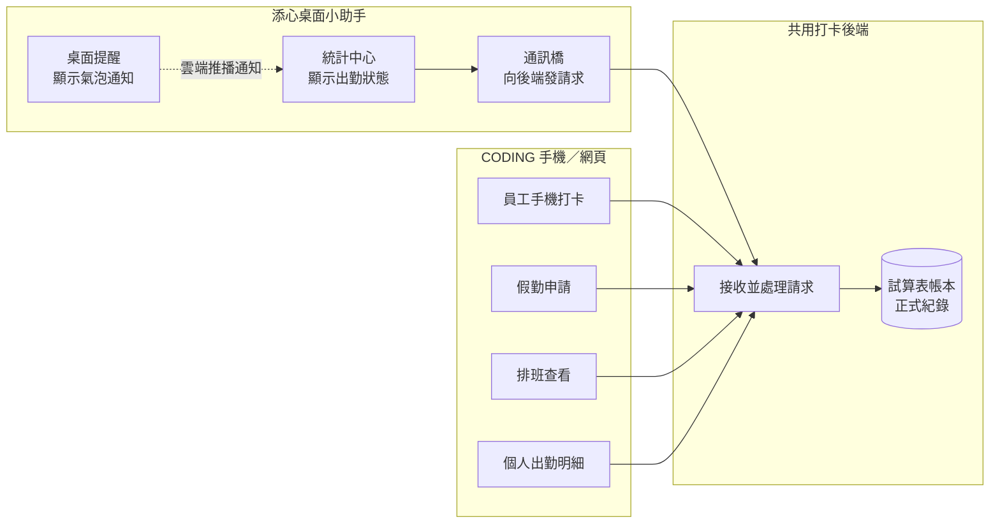
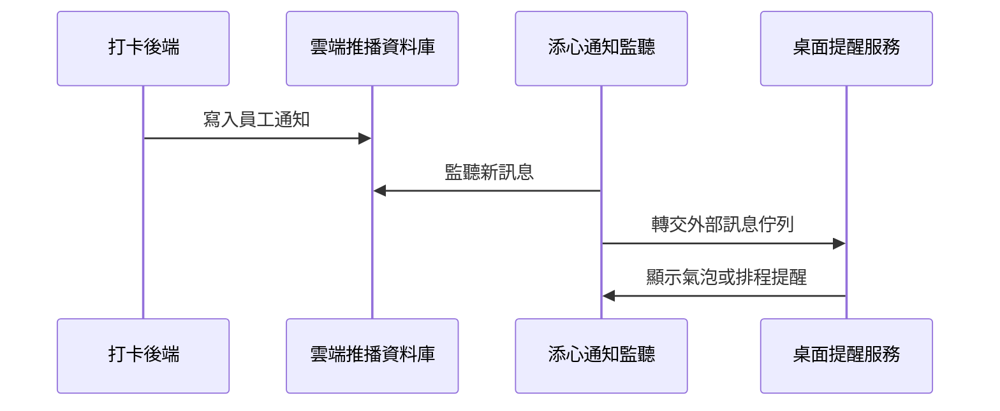

# 添心小助手 × CODING 出勤模組整合規格
> 版本 v1.0 | 2026-07-04 | 跨專案路線圖

## 1. 目的
讓 **Electron 桌面小助手** 與 **CODING 前端出勤模組**（LIFF／HUB）共用同一套 `CheckinSystem` 後端，員工在桌機與手機看到的打卡、假勤、排班狀態一致，且通知管線可互通。

## 2. 系統邊界



**程式對照表**

| 白話（圖上寫的） | 程式對照（開發用） |
| :--- | :--- |
| 統計中心／顯示出勤狀態 | `monitor/` 統計中心 UI |
| 通訊橋／向後端發請求 | `apiBridge.js` |
| 桌面提醒／顯示氣泡通知 | `reminderService.js` |
| 員工手機打卡 | `CODING/checkin.html`（LIFF） |
| 假勤申請 | `CODING/leave_request.html` |
| 排班查看 | `CODING/shift_schedule.html` |
| 個人出勤明細 | `CODING/my_personal.html` → `attendance_report.html` |
| 接收並處理請求 | `backend/CheckinSystem/WebApp.js`（`doGet` / `doPost`） |
| 試算表帳本／正式紀錄 | Google Sheets（`員工資料`、`打卡紀錄` 等分頁） |
| 雲端推播通知（虛線） | Firebase RTDB `/notifications/{userId}` |

| 層級 | 添心 | CODING | 共用 |
| :--- | :--- | :--- | :--- |
| 執行環境 | Electron + IPC | 瀏覽器 / LIFF / HUB iframe | — |
| 身分驗證 | PC 綁定 `userId`（Config） | LINE `liff.getProfile().userId` | **同一 `員工資料.userId`（LINE UID）** |
| 打卡入口 | `directCheckin` GET 無 action | `checkin.html` 同路由 + GPS | `Logic_Checkin` |
| 資料權威 | 本地優先（已打卡不覆寫） | 離線佇列 + 雲端 | Sheet 為最終帳本 |

## 3. CODING 四頁分析

### 3.1 `checkin.html` — 員工打卡（LIFF）
- **身分**：`liff.init` → `liff.getProfile()` → `userId` / `displayName`
- **API**：
  - 預設打卡：GET `GAS_URL` + `userId`, `userName`, `lat`, `lon`, `source`（richmenu/hub/assistant）
  - `get_all_sites`、`get_off_site_reason_presets`（`page=attendance_api`）
- **本地**：`localStorage` 離線佇列、歷史、profile 快取
- **添心對齊**：`apiBridge.directCheckin()` 已對齊同 GET 路由、`source=assistant`；缺 GPS 精度與離場說明 UI

### 3.2 `leave_request.html` — 假勤申請
- **API（GET）**：`get_employees`（filter=all）、`get_my_leave_requests`
- **API（POST）**：`submit_leave_request`、`update_leave_request`、`handle_approval`；撤回／取消用 `request_leave_cancellation` 等
- **身分**：LIFF profile；管理分頁依 `permission`
- **添心現況**：**未整合**；僅托盤開外部連結

### 3.3 `shift_schedule.html` — 員工排班
- **API**：`get_employees`、`get_latest_schedule`、`save_schedule_version`（POST）
- **身分**：URL 參數或員工選擇器（非 LIFF 強制）
- **添心現況**：**未整合**；排班變更不可見於桌面提醒

### 3.4 `my_personal.html` — 個人出勤入口
- **行為**：redirect → `attendance_report.html?mode=personal`
- **API**：`get_report`、`get_my_leave_requests`、`attendance_appeal`、`payroll_review`、`get_config`
- **規格**：見 `CODING/SPEC/17_個人薪資出勤頁計劃書.md`
- **添心現況**：可 `shell.openExternal` 開 HUB，但無 deep link 帶 `uid`

## 4. 共用後端 API（CheckinSystem）

**Base URL**：與 `checkin.html` / `config.js` `CHECKIN_API_URL` 相同 GAS `/exec`。

### 4.1 添心已使用
| action | 方法 | 用途 |
| :--- | :--- | :--- |
| （預設打卡路由） | GET | 桌機打卡 |
| `get_work_info` | GET | 今日上下班狀態 |
| `get_employee_by_pc` | GET | 開機綁定 |
| `bind_pc_to_employee` | POST | 綁定 PC |
| `get_employees` | GET | 員工快取／過濾 |
| `submit_productivity_report` | POST | 生產力上報 |
| `update_status` | POST | 心跳 |
| `get_rules` | GET | 分類規則 |

### 4.2 CODING 出勤擴充（添心尚未用）
| action | 頁面 | 用途 |
| :--- | :--- | :--- |
| `get_report` | attendance_report | 月曆／明細 |
| `get_my_leave_requests` | leave_request, attendance_report | 假單列表 |
| `submit_leave_request` | leave_request | 請假／加班 |
| `get_latest_schedule` / `save_schedule_version` | shift_schedule | 排班 |
| `attendance_appeal` | attendance_report, approval_dashboard | 出勤申訴 |
| `payroll_review` | attendance_report | 薪資核對 |
| `get_pending_requests` | approval_dashboard | 主管待審 |
| `add_manual_checkin` | approval_dashboard | 補登 |

### 4.3 資料模型（試算表分頁）
| 分頁 | 用途 | 消費端 |
| :--- | :--- | :--- |
| `員工資料` | userId, userName, permission, group, pcName | 全系統 |
| `打卡紀錄` | 每筆打卡時間、座標、案場、離場說明 | checkin, get_report |
| `排班歷史紀錄` | 假別、排休、加班 | shift, leave, report |
| `UserStatus` | 心跳、當前 App | 添心 update_status, HUB 戰情室 |
| `出勤申訴` | 申訴單（A1） | attendance_report |
| `薪資核對申請` | 薪資送審 | payroll_review |

## 5. 身分驗證差異與統一策略

| 面向 | CODING LIFF | 添心 Electron |
| :--- | :--- | :--- |
| 主鍵 | LINE UID from LIFF | Config `boundEmployee.userId`（須與 LINE UID 一致） |
| 綁定流程 | LIFF 頁面 | `get_employee_by_pc` + 手動 LIFF 綁定連結 |
| 權限 | 後端查 `permission` | `config.isAdmin()` 本地判定 + 後端 |
| 風險 | URL 可偽造 userId（後端 P0） | PC 綁定後 userId 存本地（需防篡改） |

**統一原則**（對齊 `CODING/SPEC/19_HUB與會計全域身分傳承.md`）：
- 全公司以 `員工資料.userId` 為唯一員工鍵。
- 添心 API 呼叫一律帶 `userId`；待後端 Token 上線後改帶 `sessionToken`。

## 6. 衝突與缺口

| 議題 | 說明 | 建議 |
| :--- | :--- | :--- |
| 桌面 vs 手機打卡 | 兩端皆可寫 `打卡紀錄` | 以 Sheet 時間戳為準；添心本地優先僅影響 UI，不阻擋手機紀錄 |
| 本地優先 vs 雲端權威 | 添心已打卡後不拉 `get_work_info` | Phase 2 加「手動同步」或每日 07:00 強制校準一次 |
| GPS / 離場說明 | 桌機無精準 GPS、無離場 UI | 維持 `source=assistant` + 據點/IP；異常由主管審核 |
| 假勤／排班不可見 | 桌面無入口 | Phase 1 deep link；Phase 2 內嵌摘要 |
| API 無鑑權 | 知道 URL 即可呼叫 | 後端 AuthMiddleware（跨專案 P0） |
| 通知 | LINE / Firebase 在 HUB | 添心已聽 Firebase；假勤審核結果可擴充 payload type |

## 7. 分階段 Roadmap

### Phase 1 — 導流與狀態一致（最小可行）
**目標**：桌機可一鍵到 CODING 個人出勤，打卡狀態與手機一致。

| 項目 | 內容 |
| :--- | :--- |
| 深連結 | 統計中心新增「我的出勤」→ `attendance_report.html?mode=personal&uid={userId}`（HUB 或靜態 hosting） |
| 狀態同步 | 維持現有本地優先 + 未打卡 10min 輪詢；啟動時 `get_work_info` |
| 通知 | Firebase 訊息 type 擴充：`leave_approved`、`schedule_changed` → reminderService 氣泡 |
| 驗收 | ① 手機打卡後 10min 內桌機顯示上班時間 ② 桌機打卡後 HUB 個人頁一致 ③ 深連結免重新綁定 |

### Phase 2 — 摘要嵌入（減少切換）
**目標**：常用資訊不離開統計中心。

| 項目 | 內容 |
| :--- | :--- |
| API | `get_my_leave_requests`（近 3 筆）、`get_report`（本月摘要） |
| UI | 統計中心卡片：今日假別、待審假單數、本月遲到累計 |
| 同步 | 已打卡日 07:00 可選強制 `get_work_info` 校準 |
| 驗收 | 請假核准後 30min 內桌面卡片更新；不需開瀏覽器即可見待審數 |

### Phase 3 — 雙向操作與審批（主管）
**目標**：Level 5 可在桌面處理簡要審批。

| 項目 | 內容 |
| :--- | :--- |
| API | `get_pending_requests`、`handle_approval`（POST） |
| UI | 管理員托盤或統計中心「待審」清單 |
| 安全 | 依賴後端 Token + `permission >= 4` |
| 驗收 | 主管僅在 Level 5 可見；審批後員工 Firebase 收到通知 |

## 8. 具體銜接方式

### 8.1 深連結（Phase 1）
```text
https://info.tanxin.space/modules/attendance/attendance_report.html?mode=personal&uid={userId}&name={userName}
```
- 實作：`appCore.openLinkWindow` 或新 IPC `open-attendance-personal`
- 參數對齊 HUB `19_HUB與會計全域身分傳承.md`

### 8.2 共用 API（Phase 1–2）
- 一律經 `apiBridge.get/post`，`page=attendance_api`
- 新增薄封裝：`getMyLeaveRequests(userId)`、`getAttendanceSummary(userId, month)`

### 8.3 狀態同步（已部分實作）
- 寫入：`directCheckin` → 樂觀本地 → Sheet
- 讀取：未打卡 → `get_work_info`；已打卡 → 跳過（`appCore` statsRefresh）
- 衝突：`handleWorkInfoUpdate` 拒絕雲端空值覆蓋

### 8.4 通知管線（Phase 1）


**程式對照表**

| 白話（圖上寫的） | 程式對照（開發用） |
| :--- | :--- |
| 打卡後端 | `backend/CheckinSystem`（GAS WebApp） |
| 雲端推播資料庫 | Firebase RTDB |
| 寫入員工通知 | `FB` 路徑 `/notifications/{userId}` |
| 添心通知監聽 | `firebaseService.js`（`child_added` 監聽） |
| 監聽新訊息 | `firebaseService` 訂閱 RTDB 節點 |
| 桌面提醒服務 | `reminderService.js` |
| 轉交外部訊息佇列 | `reminderService.processQueue`（`isExternal`） |
| 顯示氣泡或排程提醒 | `reminderService` 氣泡／MDQ 排程 |

- 擴充 `message.type`：`attendance_reminder`、`leave_result`、`appeal_result`

## 9. 不在本路線圖範圍
- 重寫 `shift_schedule.html` 於 Electron 內（成本高）
- 修改熱更新殼層（`main.js` / `hotReloader` / `updater` / `versionService`）
- 後端 Token 實作（屬 `backend/CheckinSystem`，但為 Phase 3 前置）

## 10. 關聯文件
- `PROJECT_CONTEXT.md` — 添心 API 速查
- `CODING/SPEC/17_個人薪資出勤頁計劃書.md`
- `CODING/SPEC/19_HUB與會計全域身分傳承.md`
- `backend/CheckinSystem/SPEC/打卡全流程後端解析.md`
- `CODING/SPEC/全專案系統大綱.md` §員工出勤打卡生活動線

---
*本文件為跨專案整合之單一真相來源；實作時以最小 diff 增補 apiBridge／monitor，不擴張殼層。*
